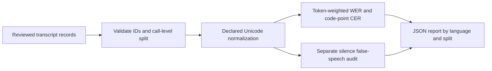

> **Proprietary - All Rights Reserved.** Licensed to Sandeep Grover. No reuse, copying, modification, or distribution without prior written permission. See LICENSE.

# Call transcription evaluation audit

An offline evaluation component for English, Hindi and Hinglish call transcripts.
This repository does **not** run Whisper, contain client calls, or demonstrate model accuracy.
All example references, hypotheses and timings are constructed fixtures. Model selection and
improvement require authorized real recordings, reviewed transcripts and measured inference.



## Run

Python 3.10+, standard library only:

```sh
python -m unittest -v
python main.py synthetic_calls.jsonl
```

The JSONL schema is shown in the fixture. Every row needs a unique `id`, a shared
`call_id` for segments from the same call, `split` (train/validation/test), `language`,
`reference`, `hypothesis`, a reviewed `is_silence` boolean, and positive finite
`audio_seconds`/`inference_seconds`. Missing transcripts fail rather than becoming silence.
Segments from one call cannot cross splits. Speaker, customer and recording-duplicate leakage
need a richer provenance inventory and are not inferred by this small component.

## Interpretation

* Normalization uses NFC, case folding and collapsed whitespace. Punctuation and scripts remain.
* WER is summed edit count divided by summed reference tokens within each group, not an average
  of per-segment percentages. Insertions can produce WER above 100%.
* CER here means Unicode code-point error rate with spaces removed, not grapheme-cluster CER.
* Decide Devanagari versus Romanized Hindi conventions with reviewers first. This code does not
  assume transliterations or alternate spellings are equivalent.
* Empty references require explicit silence labels. Speech invented during silence is reported
  separately, with null WER for silence-only groups.
* RTF is summed inference time / summed audio duration. Compare only matched hardware and timing
  boundaries. The sample's timings are fictional and provide no performance evidence.
* There are no confidence intervals or model comparisons in this small fixture. A real audit
  needs call-level uncertainty estimates and a locked holdout covering language, channel,
  overlap, names/numbers and silence. Choose settings on validation data, then evaluate once.

## Real assessment plan

Inventory input codecs/sample rates and channels; preserve original calls. Establish permission,
redaction and retention before moving recordings. Compare the current multilingual transcription
settings with controlled changes to VAD, segmentation, language handling, prompts and decoding.
Do not claim resampling restores missing telephone bandwidth or that denoising always helps.
Measure errors and latency separately for English, Hindi and mixed speech. Human reviewers
resolve ambiguous words and the agreed spelling policy. No deployment or fine-tuning guarantee.

Primary technical references:
* https://huggingface.co/openai/whisper-large-v3-turbo
* https://github.com/openai/whisper
